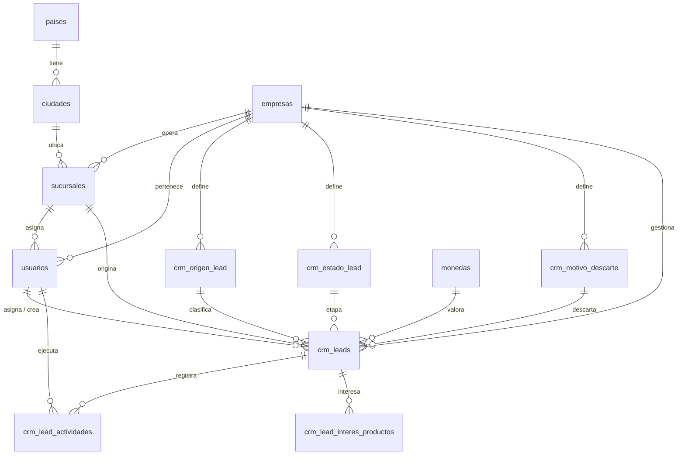

# Documentación de la Base de Datos — Tesserak

Este documento describe cómo está diseñada y construida la base de datos de **Tesserak**, los **patrones de diseño** que sigue, el propósito de **cada tabla** y el estado actual de implementación en PostgreSQL.

- **Motor:** PostgreSQL 14+
- **Gestión de esquema:** Migraciones SQL versionadas con `golang-migrate` (embebidas en el binario Go en `backend/migrations/`). No se usa `AutoMigrate` de GORM para no perder índices únicos parciales, restricciones `CHECK` ni claves foráneas compuestas.
- **Acceso a datos:** GORM sobre `pgx/v5`.
- **Fuente del diseño completo:** `Diseño aplicación.drawio` (47 tablas en 8 dominios).

---

## 1. Patrones de diseño de la base de datos

| Patrón | Dónde se aplica | Qué resuelve |
|---|---|---|
| **Multi-tenant con discriminador (`empresa_id`)** | `sucursales`, `usuarios`, `crm_*`, `ventas`, `compras`, `lealtad_*`, `empresa_productos`, `tercero_empresa` | Múltiples empresas comparten la misma base de datos con aislamiento lógico por `empresa_id`. |
| **Integridad multi-tenant por FK compuesta** | `usuarios (sucursal_id, empresa_id)`, `crm_leads (sucursal_id/origen_id/estado_id/motivo_descarte_id, empresa_id)` | Impide a nivel de motor que un registro de la empresa A referencie una sucursal, origen, estado o motivo de la empresa B. |
| **Soft Delete + Índices únicos parciales** | `empresas`, `sucursales`, `usuarios`, `crm_origen_lead`, `crm_estado_lead`, `crm_motivo_descarte`, `crm_leads`, `crm_lead_actividades` | `deleted_at TIMESTAMPTZ` conserva el historial sin borrar físicamente. Los índices `UNIQUE (...) WHERE deleted_at IS NULL` permiten reutilizar emails, nombres de usuario o NITs de registros eliminados. |
| **Catálogo maestro + Vinculación por empresa** | `tercero_maestro` → `tercero_empresa` | Evita duplicar información base de terceros entre tenants, permitiendo configuración propia por empresa. |
| **Supertipo–Subtipo para Artículos (Productos y Servicios)** | `articulos` → `productos` / `servicios` | Aísla los artículos por empresa (`empresa_id`) y separa los atributos comunes (`codigo`, `nombre`, `unidad_medida_id`, `categoria_id`, `grupo_impuesto_id`, `marca_id` opcional) de las extensiones 1:1 para productos físicos e inventario vs. servicios (duración en horas, modalidad, programación). |
| **Party / Role (Supertipo–Subtipo / Class Table Inheritance)** | `tercero_maestro` → `tercero_empresa` → `tercero_empresa_roles` → `clientes` / `proveedores` / `empleados` | Una misma persona o empresa puede ser simultáneamente cliente, proveedor y empleado sin duplicar sus datos de identidad. |
| **Header–Detail (Cabecera–Detalle)** | `ventas` / `ventas_detalle`, `compras` / `compras_detalle`, `documento_inventario` / `movimiento_inventario_detalle` | Separa metadatos y totales del documento de sus líneas de ítems. |
| **Ledger (Libro mayor inmutable) + Saldo materializado** | `lealtad_transacciones` + `lealtad_cuentas.saldo_puntos`; `movimiento_inventario_detalle` + `inventario_stock` | Mantiene trazabilidad completa de cada movimiento mientras conserva un saldo/stock actualizado para lecturas rápidas. |
| **RBAC (Control de acceso basado en roles)** | `usuarios` ↔ `usuario_roles` ↔ `roles_sistema` ↔ `rol_permisos` ↔ `permisos` | Desacopla usuarios de permisos mediante roles asignables. |
| **Feature Flags por tenant (Suscripción modular)** | `modulos` ↔ `modulo_empresa` | Permite activar o desactivar módulos funcionales por empresa. |
| **Pipeline / Máquina de estados configurable** | `crm_estado_lead` + `crm_leads` + `crm_motivo_descarte` | Cada empresa define sus propias etapas de venta, orden y estados finales, con seguimiento vía `crm_lead_actividades`. |
| **Auditoría temporal** | Tablas transaccionales y maestras | Uso estándar de `created_at`, `updated_at` (y `deleted_at` donde aplica) en `TIMESTAMPTZ` (UTC). |

---

## 2. Diagrama ER de las tablas implementadas (Migraciones `000001` y `000002`)

---

## 3. Catálogo completo de tablas por dominio

> **Leyenda de estado:**
> - **Implementada**: existe en `backend/migrations/` y está lista para PostgreSQL.
> - **Diseñada**: definida en `Diseño aplicación.drawio`, pendiente de migración SQL.

### 3.1 Geografía y Monedas (Catálogos globales)

| Tabla | Estado | Para qué sirve | Patrón de diseño |
|---|---|---|---|
| `paises` | Implementada (`000001`, `000003`) | Catálogo ISO de países (`nombre`, `iso_alpha_2`, `iso_alpha_3`, `codigo_numerico`, `nombre_oficial`). | **Lookup / Catálogo de referencia global**. |
| `ciudades` | Implementada (`000001`) | Ciudades asociadas a un país (`pais_id`, `nombre` único por país). | **Catálogo jerárquico** (1:N con `paises`). |
| `monedas` | Implementada (`000002`) | Catálogo ISO de divisas (`codigo_iso`, `nombre_moneda`, `simbolo`) usado en CRM, ventas, inventario y lealtad. | **Lookup / Catálogo de referencia global**. |

### 3.2 Empresas, Sucursales y Módulos (Multi-tenancy)

| Tabla | Estado | Para qué sirve | Patrón de diseño |
|---|---|---|---|
| `empresas` | Implementada (`000001`) | Entidad raíz de cada tenant (`nombre_legal`, `razon_social`, `identificador_fiscal` único activo, datos de contacto y logo). | **Tenant Root + Soft Delete + Índice único parcial**. |
| `sucursales` | Implementada (`000001`) | Sedes físicas o puntos de operación de una empresa. Expone `UNIQUE (id, empresa_id)` para FKs compuestas. | **Jerarquía de Tenant + Composite Key para aislamiento**. |
| `modulos` | Diseñada | Catálogo de módulos funcionales de la plataforma (CRM, Inventario, Ventas, Lealtad, etc.). | **Catálogo de referencia / Feature registry**. |
| `modulo_empresa` | Diseñada | Activa módulos contratados por cada empresa con su fecha de activación. | **Tabla puente N:M + Feature Flags por tenant**. |

### 3.3 Seguridad, Usuarios y RBAC

| Tabla | Estado | Para qué sirve | Patrón de diseño |
|---|---|---|---|
| `usuarios` | Implementada (`000001`, `000010`) | Credenciales y perfil de acceso. Incluye identificador externo único `key` (`UUID v4`, `DEFAULT gen_random_uuid()`, índice `ux_usuarios_key`). Cada usuario pertenece a una sucursal y empresa (`FK (sucursal_id, empresa_id)`). Email y `nombre_usuario` son únicos por empresa (insensibles a mayúsculas) entre usuarios no borrados. Contraseña con `bcrypt`. | **Multi-tenant con FK compuesta + UUID v4 público + Soft Delete + Índice único parcial**. |
| `roles_sistema` | Diseñada | Define roles de acceso al sistema (ej. Administrador, Vendedor, Cajero). | **RBAC (Role)**. |
| `permisos` | Diseñada | Define permisos granulares de acciones en el sistema. | **RBAC (Permission)**. |
| `usuario_roles` | Diseñada | Asigna uno o varios roles del sistema a cada usuario. | **Tabla puente N:M (RBAC)**. |
| `rol_permisos` *(en drawio sin título)* | Diseñada | Asocia permisos a cada rol del sistema. | **Tabla puente N:M (RBAC)**. |

### 3.4 Módulo CRM (Gestión de prospectos y pipeline)

| Tabla | Estado | Para qué sirve | Patrón de diseño |
|---|---|---|---|
| `crm_origen_lead` | Implementada (`000002`) | Canales de captación configurables por empresa (Web, Referido, WhatsApp, Evento, etc.). | **Catálogo por tenant + Soft Delete + FK compuesta**. |
| `crm_estado_lead` | Implementada (`000002`) | Etapas ordenadas del embudo comercial por empresa (`orden`, `es_estado_final`). | **Máquina de estados configurable + Catálogo por tenant**. |
| `crm_motivo_descarte` | Implementada (`000002`) | Razones por las que se descarta o pierde un lead (Precio, Competencia, Sin respuesta, etc.). | **Catálogo por tenant + Soft Delete**. |
| `crm_leads` | Implementada (`000002`) | Prospectos comerciales con datos de contacto, calificación (`temperatura`: `FRIO`/`TIBIO`/`CALIENTE`, `score`: 0–100), `valor_estimado`, asignación a usuario, estado actual y trazabilidad de conversión (`convertido`, `fecha_conversion`, `convertido_tercero_empresa_rol_id`). | **Entidad transaccional multi-tenant + FK compuestas + Soft Delete + Conversión a Party/Role**. |
| `crm_lead_actividades` | Implementada (`000002`) | Historial y agenda de seguimiento sobre cada lead (`LLAMADA`, `CORREO`, `REUNION`, `WHATSAPP`, `TAREA`, `NOTA`) con fecha de vencimiento y estado (`PENDIENTE`, `COMPLETADA`, `CANCELADA`). | **Activity Log / Task Tracking + Soft Delete**. |
| `crm_lead_interes_productos` | Implementada (`000002`) | Productos, categorías o notas de interés asociadas a un lead con su cantidad estimada. | **Relación 1:N de detalle con referencia flexible (producto, categoría o nota)**. |
| `crm_tipos_campana` | Implementada (`000005`) | Catálogo de tipos de campaña de marketing por empresa con 7 valores semilla. | **Catálogo por tenant + Soft Delete**. |
| `crm_campanas` | Implementada (`000005`) | Campañas de marketing con vigencia, presupuesto, moneda, estado y trazabilidad multiempresa. | **Entidad multi-tenant + FK compuestas + Soft Delete**. |
| `crm_campana_leads` | Implementada (`000005`) | Relación N:M entre campañas y leads con atribución (`first_touch`/`last_touch`/`influencia`) y parámetros UTM. | **Tabla puente N:M multi-tenant + Índice parcial `first_touch`**. |
| `crm_campana_gastos` | Implementada (`000005`) | Registro de gastos asociados a cada campaña en su moneda correspondiente. | **Relación 1:N multi-tenant + Soft Delete**. |
| `crm_estado_oportunidades` | Implementada (`000006`/`000007`) | Etapas ordenadas de oportunidades con probabilidad (%) y banderas `es_ganada`/`es_perdida`. | **Máquina de estados configurable + Soft Delete**. |
| `crm_oportunidades` | Implementada (`000007`) | Negociaciones comerciales vinculables a lead y campaña, con valor estimado, prioridad y fecha de cierre. | **Entidad multi-tenant + FK compuestas + Soft Delete**. |

### 3.5 Terceros (Clientes, Proveedores y Empleados)

| Tabla | Estado | Para qué sirve | Patrón de diseño |
|---|---|---|---|
| `tercero_maestro` | Diseñada | Registro único de identidad de una persona natural o jurídica (tipo/número de identificación, razón social, país, naturaleza jurídica). | **Party Pattern (Supertipo maestro compartido)**. |
| `tercero_empresa` | Diseñada | Vincula un tercero del maestro con una empresa específica. | **Tabla puente N:M (Catálogo compartido → Tenant)**. |
| `roles_tercero` | Diseñada | Catálogo de roles de negocio que puede tener un tercero (Cliente, Proveedor, Empleado). | **Catálogo de roles de negocio**. |
| `tercero_empresa_roles` | Diseñada | Asigna roles concretos a un tercero dentro de una empresa. Es la referencia central que usan ventas, compras, lealtad y CRM. | **Party–Role Pattern**. |
| `clientes` | Diseñada | Datos específicos de un tercero con rol cliente (`limite_credito`, `condiciones_pago`, `fecha_registro`). | **Class Table Inheritance (Subtipo de rol)**. |
| `proveedores` | Diseñada | Datos específicos de un tercero con rol proveedor (`evaluacion`). | **Class Table Inheritance (Subtipo de rol)**. |
| `empleados` | Diseñada | Datos laborales de un tercero con rol empleado (`fecha_contratacion`, `salario`, `tipo_contrato_id`, `cargo_id`, `estado`). | **Class Table Inheritance (Subtipo de rol)**. |
| `cargos` | Diseñada | Catálogo de cargos laborales para empleados. | **Lookup / Catálogo**. |
| `tipos_contrato` | Diseñada | Catálogo de tipos de contrato laboral (Indefinido, Fijo, Prestación de servicios, etc.). | **Lookup / Catálogo**. |

### 3.6 Catálogo de Artículos (Productos y Servicios)

> **Decisión arquitectónica (`000008` y `000009`):** Los artículos NO se comparten globalmente entre empresas. Se eliminó el esquema `maestro_productos` + `empresa_productos` y se implementó el patrón **Class Table Inheritance (Supertipo–Subtipo)** aislado por `empresa_id`: `articulos` contiene los datos comunes y se extiende 1:1 en `productos` (físicos) y `servicios`.

| Tabla | Estado | Para qué sirve | Patrón de diseño |
|---|---|---|---|
| `articulos` | Implementada (`000009`) | Información común de productos y servicios por empresa: `codigo` (único por empresa), `nombre`, `descripcion`, `tipo_articulo_id`, `unidad_medida_id`, `categoria_id` (obligatoria), `grupo_impuesto_id` (obligatorio), `marca_id` (opcional), `estado` y `deleted_at`. | **Supertipo multi-tenant + FK compuestas + Soft Delete**. |
| `productos` | Implementada (`000009`) | Extensión 1:1 de `articulos` (`articulo_id` PK/FK) para artículos físicos: `control_inventario`, `metodo_valoracion_id` (obligatorio si controla inventario), `permite_compra` y `permite_venta`. | **Class Table Inheritance (Subtipo 1:1)**. |
| `servicios` | Implementada (`000009`) | Extensión 1:1 de `articulos` (`articulo_id` PK/FK) para servicios: `modalidad_id`, `duracion_estimada` (en horas), `requiere_programacion` y `control_consumos`. | **Class Table Inheritance (Subtipo 1:1)**. |
| `tipos_articulo` | Implementada (`000009`) | Catálogo discriminador (`PRODUCTO`, `SERVICIO`). | **Lookup / Catálogo**. |
| `metodos_valoracion` | Implementada (`000009`) | Métodos de valoración de inventario (`FIFO`, `PROMEDIO_PONDERADO`, `IDENTIFICACION_ESPECIFICA`). | **Lookup / Catálogo**. |
| `modalidades_servicio` | Implementada (`000009`) | Modalidades de prestación de servicios (`POR_HORA`, `PROYECTO`, `UNIDAD`, `SUSCRIPCION`). | **Lookup / Catálogo**. |
| `categorias_producto` | Implementada (`000008`) | Clasificación de artículos por categoría aislada por empresa (soft delete). | **Catálogo por tenant + Soft Delete**. |
| `marcas` | Implementada (`000008`) | Catálogo opcional de marcas comerciales por empresa (soft delete). | **Catálogo por tenant + Soft Delete**. |
| `unidades_medida` | Implementada (`000008`) | Unidades de comercialización (`UND`, `KG`, `LT`, `MT`, `CJ`, etc.). | **Lookup / Catálogo**. |
| `grupos_impuesto` | Implementada (`000008`) | Esquemas tributarios y tarifas porcentuales por empresa (ej. Exento 0%, IVA 19%) con soft delete. Obligatorio en `articulos`. | **Catálogo fiscal por tenant + Soft Delete**. |

### 3.7 Inventario y Bodegas

| Tabla | Estado | Para qué sirve | Patrón de diseño |
|---|---|---|---|
| `ubicaciones` | Diseñada | Bodegas, estantes o zonas físicas dentro de una sucursal. | **Jerarquía física (Sucursal → Ubicación)**. |
| `tipos_movimiento_inventario` | Diseñada | Catálogo de tipos de movimiento (Entrada, Salida, Traslado, Ajuste). | **Lookup / Catálogo**. |
| `documento_inventario` | Diseñada | Cabecera de un movimiento de inventario (consecutivo, fecha, tercero, motivo, usuario, sucursal y referencia polimórfica `documento_origen_tipo` + `documento_origen_id`). | **Header–Detail + Referencia polimórfica**. |
| `movimiento_inventario_detalle` | Diseñada | Líneas de cada documento de inventario con producto, ubicación origen/destino, cantidad, costo unitario y moneda. | **Header–Detail + Ledger de inventario (Kardex)**. |
| `inventario_stock` | Diseñada | Saldo actual y costo promedio ponderado por `empresa_producto_id` y `ubicacion_id`. | **Materialized Balance / Snapshot de existencias**. |

### 3.8 Ventas y Compras

| Tabla | Estado | Para qué sirve | Patrón de diseño |
|---|---|---|---|
| `ventas` | Diseñada | Cabecera de ventas (consecutivo, empresa, sucursal, cliente vía `tercero_empresa_rol_id`, vendedor, estado, subtotal, descuentos, impuestos y total). | **Header–Detail + Documento transaccional** (se anula por `estado`, no se borra). |
| `ventas_detalle` | Diseñada | Ítems vendidos con cantidad, precio unitario, descuento, impuesto y total por línea. | **Header–Detail**. |
| `compras` | Diseñada | Cabecera de compras a proveedores (consecutivo, factura del proveedor, fechas de compra y vencimiento, totales, usuario y sucursal). | **Header–Detail + Documento transaccional**. |
| `compras_detalle` | Diseñada | Ítems comprados con cantidad, subtotal, impuesto y total. | **Header–Detail**. |

### 3.9 Programa de Lealtad

| Tabla | Estado | Para qué sirve | Patrón de diseño |
|---|---|---|---|
| `lealtad_programas` | Diseñada | Programas de fidelización definidos por empresa con vigencia y estado. | **Entidad de configuración por tenant**. |
| `lealtad_reglas` | Diseñada | Reglas de acumulación de puntos (`puntos_por_monto`, `compra_minima`, moneda, vigencia). | **Rule Engine ligero / Estrategia parametrizada**. |
| `lealtad_cuentas` | Diseñada | Cuenta de puntos de un cliente dentro de un programa, con `saldo_puntos` materializado. | **Materialized Balance**. |
| `lealtad_transacciones` | Diseñada | Historial inmutable de acumulación, ajuste o vencimiento de puntos con `saldo_posterior` y vínculo a la venta origen. | **Append-only Ledger (Libro mayor de puntos)**. |
| `lealtad_redenciones` | Diseñada | Registro de canje de puntos por descuentos aplicados en una venta. | **Documento transaccional vinculado a cuenta y venta**. |

---

## 4. Convenciones SQL aplicadas en las migraciones

1. **Nomenclatura:** `snake_case` en minúsculas para tablas, columnas, índices y constraints. Claves foráneas siempre como `<entidad>_id`.
2. **Claves primarias:** `GENERATED ALWAYS AS IDENTITY` (`INT` para catálogos/entidades de volumen medio, `BIGINT` para entidades de alto volumen como `usuarios`, `crm_leads`, `crm_lead_actividades`).
3. **Índices y constraints nombrados explícitamente:** `uq_*` (unique), `ux_*` (unique index parcial), `ix_*` (index), `fk_*` (foreign key), `ck_*` (check). Esto permite al backend inspeccionar `pgErr.ConstraintName` y devolver errores HTTP precisos (`409`, `422`).
4. **Fechas:** siempre `TIMESTAMPTZ` almacenadas en UTC.
5. **Seguridad:** las contraseñas usan `VARCHAR(255)` (preparado para `bcrypt` o `Argon2id`) y nunca se exponen en DTOs de salida.
