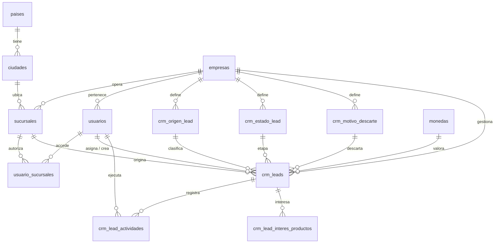

# Documentación de la Base de Datos — Tesserak

Este documento describe cómo está diseñada y construida la base de datos de **Tesserak**, los **patrones de diseño** que sigue, el propósito de **cada tabla** y el estado actual de implementación en PostgreSQL.

- **Motor:** PostgreSQL 14+
- **Gestión de esquema:** Migraciones SQL versionadas con `golang-migrate` (embebidas en el binario Go en `backend/migrations/`). No se usa `AutoMigrate` de GORM para no perder índices únicos parciales, restricciones `CHECK` ni claves foráneas compuestas.
- **Acceso a datos:** GORM sobre `pgx/v5`.
- **Fuente del diseño completo:** `Diseño aplicación.drawio` (47 tablas en 8 dominios).

---

## 1. Patrones de diseño de la base de datos

| Patrón | Dónde se aplica | Qué resuelve |
|---|---|---|
| **Multi-tenant con discriminador (`empresa_id`)** | `sucursales`, `usuarios`, `crm_*`, `tercero_maestro`, `articulos`, `listas_precios`, `com_compras`, `ventas`, `lealtad_*` | Múltiples empresas comparten la misma base de datos con aislamiento lógico por `empresa_id`. |
| **Integridad multi-tenant por FK compuesta** | `usuario_sucursales ((usuario_id, empresa_id), (sucursal_id, empresa_id))`, `crm_leads (sucursal_id/origen_id/estado_id/motivo_descarte_id, empresa_id)`, `com_compras (sucursal_id, empresa_id)`, `ven_ventas (sucursal_id/ubicacion_id/cliente_id, empresa_id)` | Impide a nivel de motor que un registro de la empresa A referencie un usuario, sucursal, ubicación, cliente, origen, estado o motivo de la empresa B. |
| **Soft Delete + Índices únicos parciales** | `empresas`, `sucursales`, `usuarios`, `crm_*`, `tercero_maestro`, `roles_tercero`, `articulos`, `listas_precios`, `com_compras` | `deleted_at TIMESTAMPTZ` conserva el historial sin borrar físicamente. Los índices `UNIQUE (...) WHERE deleted_at IS NULL` permiten reutilizar emails, nombres de usuario, identificaciones, consecutivos o NITs de registros eliminados. |
| **Supertipo–Subtipo para Artículos (Productos y Servicios)** | `articulos` → `productos` / `servicios` | Aísla los artículos por empresa (`empresa_id`) y separa los atributos comunes (`codigo`, `nombre`, `unidad_medida_id`, `categoria_id`, `grupo_impuesto_id`, `marca_id` opcional) de las extensiones 1:1 para productos físicos e inventario vs. servicios (duración en horas, modalidad, programación). |
| **Party / Role (Supertipo–Subtipo / Class Table Inheritance)** | `tercero_maestro` → `tercero_empresa_roles` → `clientes` / `proveedores` / `empleados` | Cada empresa gestiona directamente sus terceros (`tercero_maestro.empresa_id`) y una misma persona o empresa puede ser simultáneamente cliente, proveedor y empleado sin duplicar sus datos de identidad. |
| **Header–Detail (Cabecera–Detalle)** | `listas_precios` / `lista_precios_detalle`, `com_compras` / `com_compras_detalle`, `ventas` / `ventas_detalle`, `documento_inventario` / `movimiento_inventario_detalle` | Separa metadatos y totales del documento (o cabecera comercial) de sus líneas de ítems. |
| **Ledger (Libro mayor inmutable) + Saldo materializado** | `lealtad_transacciones` + `lealtad_cuentas.saldo_puntos`; `movimiento_inventario_detalle` + `inventario_stock` | Mantiene trazabilidad completa de cada movimiento mientras conserva un saldo/stock actualizado para lecturas rápidas. |
| **RBAC (Control de acceso basado en roles)** | `usuarios` ↔ `usuario_roles` ↔ `roles_sistema` ↔ `rol_permisos` ↔ `permisos` | Desacopla usuarios de permisos mediante roles asignables. |
| **Feature Flags por tenant (Suscripción modular)** | `modulos` ↔ `modulo_empresa` | Permite activar o desactivar módulos funcionales por empresa. |
| **Pipeline / Máquina de estados configurable** | `crm_estado_lead` + `crm_leads` + `crm_motivo_descarte` | Cada empresa define sus propias etapas de venta, orden y estados finales, con seguimiento vía `crm_lead_actividades`. |
| **Auditoría temporal** | Tablas transaccionales y maestras | Uso estándar de `created_at`, `updated_at` (y `deleted_at` donde aplica) en `TIMESTAMPTZ` (UTC). |

---

## 2. Diagrama ER del núcleo base y CRM (incluye `usuario_sucursales` de `000020`)

---

## 3. Catálogo completo de tablas por dominio

> **Leyenda de estado:**
> - **Implementada**: existe en `backend/migrations/` y está lista para PostgreSQL.
> - **Diseñada**: definida en `Diseño aplicación.drawio`, pendiente de migración SQL.

### 3.1 Geografía y Monedas (Catálogos globales)

| Tabla | Estado | Para qué sirve | Patrón de diseño |
|---|---|---|---|
| `paises` | Implementada (`000001`, `000003`) | Catálogo ISO de países (`nombre`, `iso_alpha_2`, `iso_alpha_3`, `codigo_numerico`, `nombre_oficial`). | **Lookup / Catálogo de referencia global**. |
| `ciudades` | Implementada (`000001`) | Ciudades asociadas a un país (`pais_id`, `nombre` único por país). | **Catálogo jerárquico** (1:N con `paises`). |
| `monedas` | Implementada (`000002`) | Catálogo ISO de divisas (`codigo_iso`, `nombre_moneda`, `simbolo`) usado en CRM, ventas, inventario y lealtad. | **Lookup / Catálogo de referencia global**. |

### 3.2 Empresas, Sucursales y Módulos (Multi-tenancy)

| Tabla | Estado | Para qué sirve | Patrón de diseño |
|---|---|---|---|
| `empresas` | Implementada (`000001`) | Entidad raíz de cada tenant (`nombre_legal`, `razon_social`, `identificador_fiscal` único activo, datos de contacto y logo). | **Tenant Root + Soft Delete + Índice único parcial**. |
| `sucursales` | Implementada (`000001`) | Sedes físicas o puntos de operación de una empresa. Expone `UNIQUE (id, empresa_id)` para FKs compuestas. | **Jerarquía de Tenant + Composite Key para aislamiento**. |
| `modulos` | Diseñada | Catálogo de módulos funcionales de la plataforma (CRM, Inventario, Ventas, Lealtad, etc.). | **Catálogo de referencia / Feature registry**. |
| `modulo_empresa` | Diseñada | Activa módulos contratados por cada empresa con su fecha de activación. | **Tabla puente N:M + Feature Flags por tenant**. |

### 3.3 Seguridad, Usuarios y RBAC

| Tabla | Estado | Para qué sirve | Patrón de diseño |
|---|---|---|---|
| `usuarios` | Implementada (`000001`, `000010`, `000020`) | Credenciales y perfil de acceso. Incluye identificador externo único `key` (`UUID v4`, `DEFAULT gen_random_uuid()`, índice `ux_usuarios_key`). Se asocia directamente a `empresas` (`empresa_id`) y expone `UNIQUE (id, empresa_id)`. Email y `nombre_usuario` son únicos por empresa (insensibles a mayúsculas) entre usuarios no borrados. Contraseña con `bcrypt`. | **Multi-tenant con Composite Key + UUID v4 público + Soft Delete + Índice único parcial**. |
| `usuario_sucursales` | Implementada (`000020`) | Tabla intermedia N:M que relaciona `usuarios` con una o varias `sucursales` de la misma empresa (`es_principal` marca la sucursal predeterminada, con índice único parcial por usuario). Usa FKs compuestas `(usuario_id, empresa_id)` y `(sucursal_id, empresa_id)`. | **Tabla puente N:M + FKs compuestas multi-tenant**. |
| `roles_sistema` | Implementada (`000021`–`000026`) | Catálogo global de roles de acceso al sistema con semilla `ADMINISTRADOR`, `ADMINISTRADOR_SUCURSAL`, `GESTOR_VENTAS`, `ASESOR_COMERCIAL`, `GESTOR_COMPRAS` y `USUARIO` (`es_sistema = TRUE`). | **RBAC (Role)**. |
| `permisos` | Diseñada | Define permisos granulares de acciones en el sistema. | **RBAC (Permission)**. |
| `usuario_roles` | Implementada (`000021`) | Asigna uno o varios roles de sistema a cada usuario (`PK (usuario_id, rol_id)`). | **Tabla puente N:M (RBAC)**. |
| `rol_permisos` *(en drawio sin título)* | Diseñada | Asocia permisos a cada rol del sistema. | **Tabla puente N:M (RBAC)**. |

### 3.4 Módulo CRM (Gestión de prospectos y pipeline)

| Tabla | Estado | Para qué sirve | Patrón de diseño |
|---|---|---|---|
| `crm_origen_lead` | Implementada (`000002`) | Canales de captación configurables por empresa (Web, Referido, WhatsApp, Evento, etc.). | **Catálogo por tenant + Soft Delete + FK compuesta**. |
| `crm_estado_lead` | Implementada (`000002`) | Etapas ordenadas del embudo comercial por empresa (`orden`, `es_estado_final`). | **Máquina de estados configurable + Catálogo por tenant**. |
| `crm_motivo_descarte` | Implementada (`000002`) | Razones por las que se descarta o pierde un lead (Precio, Competencia, Sin respuesta, etc.). | **Catálogo por tenant + Soft Delete**. |
| `crm_leads` | Implementada (`000002`) | Prospectos comerciales con datos de contacto, calificación (`temperatura`: `FRIO`/`TIBIO`/`CALIENTE`, `score`: 0–100), `valor_estimado`, asignación a usuario, estado actual y trazabilidad de conversión (`convertido`, `fecha_conversion`, `convertido_tercero_empresa_rol_id`). | **Entidad transaccional multi-tenant + FK compuestas + Soft Delete + Conversión a Party/Role**. |
| `crm_lead_actividades` | Implementada (`000002`) | Historial y agenda de seguimiento sobre cada lead (`LLAMADA`, `CORREO`, `REUNION`, `WHATSAPP`, `TAREA`, `NOTA`) con fecha de vencimiento y estado (`PENDIENTE`, `COMPLETADA`, `CANCELADA`). | **Activity Log / Task Tracking + Soft Delete**. |
| `crm_lead_interes_productos` | Implementada (`000002`) | Productos, categorías o notas de interés asociadas a un lead con su cantidad estimada. | **Relación 1:N de detalle con referencia flexible (producto, categoría o nota)**. |
| `crm_tipos_campana` | Implementada (`000005`) | Catálogo de tipos de campaña de marketing por empresa con 7 valores semilla. | **Catálogo por tenant + Soft Delete**. |
| `crm_campanas` | Implementada (`000005`) | Campañas de marketing con vigencia, presupuesto, moneda, estado y trazabilidad multiempresa. | **Entidad multi-tenant + FK compuestas + Soft Delete**. |
| `crm_campana_leads` | Implementada (`000005`) | Relación N:M entre campañas y leads con atribución (`first_touch`/`last_touch`/`influencia`) y parámetros UTM. | **Tabla puente N:M multi-tenant + Índice parcial `first_touch`**. |
| `crm_campana_gastos` | Implementada (`000005`) | Registro de gastos asociados a cada campaña en su moneda correspondiente. | **Relación 1:N multi-tenant + Soft Delete**. |
| `crm_estado_oportunidades` | Implementada (`000006`/`000007`) | Etapas ordenadas de oportunidades con probabilidad (%) y banderas `es_ganada`/`es_perdida`. | **Máquina de estados configurable + Soft Delete**. |
| `crm_oportunidades` | Implementada (`000007`) | Negociaciones comerciales vinculables a lead y campaña, con valor estimado, prioridad y fecha de cierre. | **Entidad multi-tenant + FK compuestas + Soft Delete**. |

### 3.5 Terceros (Clientes, Proveedores y Empleados)

> **Decisión arquitectónica (`000014`):** Los terceros se aíslan directamente por empresa mediante `tercero_maestro.empresa_id` (FK a `empresas`), eliminando la tabla intermedia `tercero_empresa`.

| Tabla | Estado | Para qué sirve | Patrón de diseño |
|---|---|---|---|
| `tercero_maestro` | Implementada (`000014`) | Registro de identidad de una persona natural o jurídica aislado por empresa (`empresa_id`, `tipo_identificacion`, `numero_identificacion` único por empresa, `razon_social`, `pais_id`, `naturaleza_juridica`, `email`, `telefono`, `direccion`, `activo`, `deleted_at`). | **Party Pattern multi-tenant + Soft Delete + Índice único parcial**. |
| `roles_tercero` | Implementada (`000013`) | Catálogo de roles de negocio que puede tener un tercero (`codigo`, `nombre_rol`, `descripcion`, `activo`, `es_sistema`, `deleted_at`). Incluye semilla inicial de roles base protegidos: **`CLIENTE`** (*Cliente*), **`PROVEEDOR`** (*Proveedor*) y **`EMPLEADO`** (*Empleado*). | **Catálogo de roles de negocio + Semilla base + Soft Delete**. |
| `tercero_empresa_roles` | Implementada (`000015`) | Asigna uno o varios roles concretos a un tercero (`tercero_id` → `tercero_maestro.id`, `rol_id` → `roles_tercero.id`, con `UNIQUE (tercero_id, rol_id)`). Es la referencia central que usan ventas, compras, lealtad y CRM. | **Party–Role Pattern (N:M)**. |
| `clientes` | Diseñada | Datos específicos de un tercero con rol cliente (`limite_credito`, `condiciones_pago`, `fecha_registro`). | **Class Table Inheritance (Subtipo de rol)**. |
| `proveedores` | Diseñada | Datos específicos de un tercero con rol proveedor (`evaluacion`). | **Class Table Inheritance (Subtipo de rol)**. |
| `empleados` | Diseñada | Datos laborales de un tercero con rol empleado (`fecha_contratacion`, `salario`, `tipo_contrato_id`, `cargo_id`, `estado`). | **Class Table Inheritance (Subtipo de rol)**. |
| `cargos` | Diseñada | Catálogo de cargos laborales para empleados. | **Lookup / Catálogo**. |
| `tipos_contrato` | Diseñada | Catálogo de tipos de contrato laboral (Indefinido, Fijo, Prestación de servicios, etc.). | **Lookup / Catálogo**. |

### 3.6 Catálogo de Artículos (Productos y Servicios)

> **Decisión arquitectónica (`000008` y `000009`):** Los artículos NO se comparten globalmente entre empresas. Se eliminó el esquema `maestro_productos` + `empresa_productos` y se implementó el patrón **Class Table Inheritance (Supertipo–Subtipo)** aislado por `empresa_id`: `articulos` contiene los datos comunes y se extiende 1:1 en `productos` (físicos) y `servicios`.

| Tabla | Estado | Para qué sirve | Patrón de diseño |
|---|---|---|---|
| `articulos` | Implementada (`000009`) | Información común de productos y servicios por empresa: `codigo` (único por empresa), `nombre`, `descripcion`, `tipo_articulo_id`, `unidad_medida_id`, `categoria_id` (obligatoria), `grupo_impuesto_id` (obligatorio), `marca_id` (opcional), `estado` y `deleted_at`. | **Supertipo multi-tenant + FK compuestas + Soft Delete**. |
| `productos` | Implementada (`000009`) | Extensión 1:1 de `articulos` (`articulo_id` PK/FK) para artículos físicos: `control_inventario`, `metodo_valoracion_id` (obligatorio si controla inventario), `permite_compra` y `permite_venta`. | **Class Table Inheritance (Subtipo 1:1)**. |
| `servicios` | Implementada (`000009`) | Extensión 1:1 de `articulos` (`articulo_id` PK/FK) para servicios: `modalidad_id`, `duracion_estimada` (en horas), `requiere_programacion` y `control_consumos`. | **Class Table Inheritance (Subtipo 1:1)**. |
| `tipos_articulo` | Implementada (`000009`) | Catálogo discriminador (`PRODUCTO`, `SERVICIO`). | **Lookup / Catálogo**. |
| `metodos_valoracion` | Implementada (`000009`) | Métodos de valoración de inventario (`FIFO`, `PROMEDIO_PONDERADO`, `IDENTIFICACION_ESPECIFICA`). | **Lookup / Catálogo**. |
| `modalidades_servicio` | Implementada (`000009`) | Modalidades de prestación de servicios (`POR_HORA`, `PROYECTO`, `UNIDAD`, `SUSCRIPCION`). | **Lookup / Catálogo**. |
| `categorias_producto` | Implementada (`000008`) | Clasificación de artículos por categoría aislada por empresa (soft delete). | **Catálogo por tenant + Soft Delete**. |
| `marcas` | Implementada (`000008`) | Catálogo opcional de marcas comerciales por empresa (soft delete). | **Catálogo por tenant + Soft Delete**. |
| `unidades_medida` | Implementada (`000008`) | Unidades de comercialización (`UND`, `KG`, `LT`, `MT`, `CJ`, etc.). | **Lookup / Catálogo**. |
| `grupos_impuesto` | Implementada (`000008`) | Esquemas tributarios y tarifas porcentuales por empresa (ej. Exento 0%, IVA 19%) con soft delete. Obligatorio en `articulos`. | **Catálogo fiscal por tenant + Soft Delete**. |

### 3.7 Listas de Precios

Permite gestionar múltiples esquemas comerciales de precios por empresa (general, mayorista, minorista, especial), con soporte para vigencias, moneda, unidad de medida y precios escalonados por cantidad mínima.

| Tabla | Estado | Para qué sirve | Patrón de diseño |
|---|---|---|---|
| `listas_precios` | Implementada (`000011`) | Define los diferentes esquemas comerciales de precios por empresa (`nombre`, `moneda_id`, `tipo_lista`, `vigencia_desde`, `vigencia_hasta`, `estado`). | **Header–Detail + Multi-tenant + Soft Delete**. |
| `lista_precios_detalle` | Implementada (`000011`) | Contiene los precios específicos de cada artículo dentro de una lista (`lista_precio_id`, `articulo_id`, `precio`, `unidad_medida_id`, `cantidad_minima`, `vigencia_desde`, `vigencia_hasta`). | **Header–Detail (Líneas de precio con vigencia y escalas por cantidad)**. |

#### Estructura de `listas_precios`

| Campo | Tipo | Clave | Descripción |
|---|---|---|---|
| `id` | `INT` | PK | Identificador |
| `empresa_id` | `INT` | FK → `empresas.id` | Empresa propietaria |
| `nombre` | `VARCHAR(150)` | — | Nombre de la lista |
| `moneda_id` | `INT` | FK → `monedas.id` | Moneda |
| `tipo_lista` | `VARCHAR(30)` | — | Tipo de lista (`GENERAL`, `MAYORISTA`, `MINORISTA`, `ESPECIAL`) |
| `vigencia_desde` | `DATE` | — | Fecha inicial de vigencia |
| `vigencia_hasta` | `DATE` (null) | — | Fecha final de vigencia |
| `estado` | `BOOLEAN` | — | Activa/inactiva |
| `created_at` | `TIMESTAMPTZ` | — | Fecha de creación (UTC) |
| `updated_at` | `TIMESTAMPTZ` | — | Fecha de última actualización (UTC) |
| `deleted_at` | `TIMESTAMPTZ` (null) | — | Eliminación lógica (soft delete) |

#### Estructura de `lista_precios_detalle`

| Campo | Tipo | Clave | Descripción |
|---|---|---|---|
| `id` | `BIGINT` | PK | Identificador |
| `lista_precio_id` | `INT` | FK → `listas_precios.id` | Lista de precios a la que pertenece |
| `articulo_id` | `INT` | FK → `articulos.id` | Artículo al que aplica el precio |
| `precio` | `NUMERIC(14,2)` | — | Precio de venta |
| `unidad_medida_id` | `INT` | FK → `unidades_medida.id` | Unidad de medida a la que aplica |
| `cantidad_minima` | `NUMERIC(14,4)` | — | Cantidad mínima para aplicar el precio |
| `vigencia_desde` | `DATE` (null) | — | Inicio de vigencia del precio |
| `vigencia_hasta` | `DATE` (null) | — | Fin de vigencia del precio |
| `created_at` | `TIMESTAMPTZ` | — | Fecha de creación (UTC) |
| `updated_at` | `TIMESTAMPTZ` | — | Fecha de última actualización (UTC) |

### 3.8 Inventario y Bodegas (prefijo `inv_`)

| Tabla | Estado | Para qué sirve | Patrón de diseño |
|---|---|---|---|
| `inv_ubicaciones` | Implementada (`000017`) | Bodegas, estantes o zonas físicas dentro de una sucursal (`codigo` único por empresa, `nombre`, `descripcion`, `activo`, `deleted_at`). | **Jerarquía física (Sucursal → Ubicación) + Multi-tenant + Soft Delete**. |
| `inv_tipos_movimiento` | Implementada (`000017`) | Catálogo global con semilla de tipos de movimiento y su naturaleza (`ENTRADA`, `SALIDA`, `TRASLADO`): ajustes positivos/negativos, pérdidas, averías, devoluciones a proveedor, devoluciones de clientes, entradas por compra, salidas por venta y traslados. | **Lookup / Catálogo con semilla**. |
| `inv_documentos` | Implementada (`000017`) | Cabecera de un movimiento de inventario (`consecutivo` autogenerado, `fecha`, `tercero_id`, `motivo`, `observaciones`, `usuario_id`, `sucursal_id`, `estado` y referencia polimórfica `documento_origen_tipo` + `documento_origen_id`). | **Header–Detail + Referencia polimórfica + Multi-tenant**. |
| `inv_movimientos_detalle` | Implementada (`000017`) | Líneas de cada documento de inventario con `articulo_id`, `ubicacion_origen_id`, `ubicacion_destino_id`, `cantidad` y `costo_unitario`. | **Header–Detail + Ledger de inventario (Kardex)**. |
| `inv_stock` | Implementada (`000017`) | Saldo actual (`cantidad >= 0`) y `costo_promedio` ponderado por `articulo_id` y `ubicacion_id`, con FKs compuestas a `(articulo_id, empresa_id)` y `(ubicacion_id, empresa_id)`. | **Materialized Balance / Snapshot de existencias**. |

### 3.9 Ventas y Compras

| Tabla | Estado | Para qué sirve | Patrón de diseño |
|---|---|---|---|
| `ventas` | Diseñada | Cabecera de ventas (consecutivo, empresa, sucursal, cliente vía `tercero_empresa_rol_id`, vendedor, estado, subtotal, descuentos, impuestos y total). | **Header–Detail + Documento transaccional** (se anula por `estado`, no se borra). |
| `ventas_detalle` | Diseñada | Ítems vendidos con cantidad, precio unitario, descuento, impuesto y total por línea. | **Header–Detail**. |
| `com_compras` | Implementada (`000012`) | Cabecera de compras a proveedores (`consecutivo` generado automáticamente desde `secuencias_documento` si no se envía, único por empresa; `numero_factura_proveedor`, `tercero_empresa_rol_id`, `proveedor_nombre`, `moneda_id`, `estado`, fechas de compra y vencimiento, `subtotal`, `total_iva`, `total`, `observaciones`, `usuario_id`, `sucursal_id` y `deleted_at`). | **Header–Detail + Multi-tenant con FK compuesta + Soft Delete**. |
| `com_compras_detalle` | Implementada (`000012`) | Ítems comprados vinculados a `com_compras` y `articulos` (`articulo_id`, `descripcion`, `cantidad`, `costo_unitario`, `subtotal`, `impuesto`, `total`). | **Header–Detail**. |

### 3.10 Programa de Lealtad (Arquitectura Híbrida: Coalición, Global y Local)

Soporta simultáneamente **programas individuales por empresa** (`LOCAL`), **alianzas donde participan varias empresas** (`COALICION`) y **programas globales de plataforma** (`GLOBAL`). La participación de empresas en programas se modela con una relación **N:M** (`lealtad_programa_empresas`) y la identidad del beneficiario se desacopla de `empresa_id` mediante `lealtad_miembros` para permitir acumulación y redención entre múltiples empresas sin romper el aislamiento de `tercero_maestro`.

| Tabla | Estado | Para qué sirve | Patrón de diseño |
|---|---|---|---|
| `lealtad_programas` | Implementada (`000027`) | Define cada programa (`codigo`, `nombre`, `alcance`: `LOCAL`/`COALICION`/`GLOBAL`, `empresa_propietaria_id` opcional, `usuario_administrador_id`, `es_sistema`, `moneda_referencia_id`, `valor_punto_redencion`, `dias_vencimiento`, `estado`, vigencias y `deleted_at`). Incluye semilla por defecto **`Lealtad Tesserak`** (`LEALTAD_TESSERAK`, `GLOBAL`, `es_sistema = TRUE`) administrada por `ipalenciab`. | **Entidad de configuración multi-alcance + Soft Delete**. |
| `lealtad_programa_empresas` | Implementada (`000027`) | Relación N:M entre programas y empresas (`programa_id`, `empresa_id`, `rol_empresa`: `PROPIETARIA`/`ALIADA`, `permite_acumular`, `permite_redimir`, `es_programa_principal`, vigencia y `activo`). | **Coalition Loyalty / Tabla puente N:M**. |
| `lealtad_miembros` | Implementada (`000029`) | Identidad global del cliente en lealtad (`UNIQUE (pais_id, upper(tipo_identificacion), lower(numero_identificacion))`), independiente de `empresa_id`. | **Identidad desacoplada entre tenants**. |
| `lealtad_cuentas` | Implementada (`000029`) | Billetera de puntos del miembro dentro de un programa (`UNIQUE (programa_id, miembro_id)`, `saldo_puntos >= 0`, `estado`: `ACTIVA`/`BLOQUEADA`/`CERRADA`). | **Materialized Balance**. |
| `lealtad_reglas` | Implementada (`000028`) | Reglas de acumulación (`programa_id`, `empresa_id` opcional — `NULL` aplica a todo el programa, con valor aplica solo a esa empresa — `tipo_regla`: `POR_MONTO`/`BONO_FIJO`/`MULTIPLICADOR`, `puntos_por_monto`, `monto_base`, `compra_minima`, `moneda_id`, `prioridad`, vigencias y `deleted_at`). Incluye semilla de regla estándar para **`Lealtad Tesserak`** (1 punto por cada \$1.000). | **Rule Engine ligero (global u override por empresa)**. |
| `lealtad_transacciones` | Implementada (`000030`) | Libro mayor inmutable de puntos (`cuenta_id`, `programa_id`, `empresa_id`, `sucursal_id`, `venta_id`, `regla_id`, `tipo_transaccion`, `puntos`, `saldo_posterior`, `fecha_vencimiento`, `observaciones`, `created_by`, `created_at`). Permite trazabilidad y conciliación entre empresas aliadas. | **Append-only Ledger multi-empresa**. |
| `lealtad_redenciones` | Implementada (`000030`) | Registro de canje de puntos (`cuenta_id`, `transaccion_id` UQ, `empresa_id`, `sucursal_id`, `venta_id` opcional, `puntos_redimidos`, `monto_descontado`, `moneda_id`, `estado`, `observaciones`, `created_by`). | **Documento transaccional 1:1 con movimiento de ledger**. |

### 3.11 Secuencias y Consecutivos de Documentos

Permite emitir consecutivos automáticos y sin duplicados por empresa y tipo de documento (compras, ventas, cotizaciones, etc.), con prefijo configurable por empresa, relleno numérico y reinicio periódico opcional (`NUNCA`, `ANUAL`, `MENSUAL`).

| Tabla | Estado | Para qué sirve | Patrón de diseño |
|---|---|---|---|
| `tipos_documento` | Implementada (`000016`) | Catálogo global de tipos de documento que utilizan consecutivos. Semilla inicial: `COMPRA` (prefijo por defecto `COM`) y `VENTA` (prefijo por defecto `VEN`). | **Lookup / Catálogo de referencia global**. |
| `secuencias_documento` | Implementada (`000016`) | Contador y configuración de consecutivos por empresa y tipo de documento (`UNIQUE (empresa_id, tipo_documento_id)`). La emisión usa bloqueo pesimista `SELECT ... FOR UPDATE` dentro de la transacción del documento. | **Secuencia Atómica Multi-tenant + Bloqueo Pesimista (`FOR UPDATE`) + Reinicio Periódico**. |

#### Estructura de `tipos_documento`

| Campo | Tipo | Clave | Descripción |
|---|---|---|---|
| `id` | `INT` | PK | Identificador |
| `codigo` | `VARCHAR(20)` | UQ | Código único (`COMPRA`, `VENTA`, `COT`, etc.) |
| `nombre` | `VARCHAR(100)` | — | Nombre legible (`Compras`, `Ventas`) |
| `descripcion` | `VARCHAR(255)` | — | Descripción del documento |
| `prefijo_defecto` | `VARCHAR(10)` | — | Prefijo inicial sugerido (`COM`, `VEN`) |
| `activo` | `BOOLEAN` | — | Estado del tipo de documento |
| `created_at` / `updated_at` | `TIMESTAMPTZ` | — | Auditoría temporal (UTC) |

#### Estructura de `secuencias_documento`

| Campo | Tipo | Clave | Descripción |
|---|---|---|---|
| `id` | `BIGINT` | PK | Identificador |
| `empresa_id` | `INT` | FK → `empresas.id`, UQ | Empresa propietaria de la secuencia |
| `tipo_documento_id` | `INT` | FK → `tipos_documento.id`, UQ | Tipo de documento (único junto a `empresa_id`) |
| `prefijo` | `VARCHAR(10)` | — | Prefijo configurable por empresa (`COM`, `VEN`, `COT`, etc.) |
| `siguiente_numero` | `BIGINT` | — | Siguiente número disponible (`>= 1`) |
| `longitud_relleno` | `SMALLINT` | — | Cantidad de dígitos con ceros a la izquierda (por defecto `6`, ej. `COM-000001`) |
| `frecuencia_reinicio` | `VARCHAR(20)` | — | `NUNCA`, `ANUAL` o `MENSUAL` |
| `clave_periodo` | `VARCHAR(20)` (null) | — | Periodo actual (`NULL`, `YYYY` o `YYYY-MM`) |
| `activo` | `BOOLEAN` | — | Estado de la secuencia |
| `created_at` / `updated_at` | `TIMESTAMPTZ` | — | Auditoría temporal (UTC) |

---

## 4. Convenciones SQL aplicadas en las migraciones

1. **Nomenclatura:** `snake_case` en minúsculas para tablas, columnas, índices y constraints. Claves foráneas siempre como `<entidad>_id`.
2. **Claves primarias:** `GENERATED ALWAYS AS IDENTITY` (`INT` para catálogos/entidades de volumen medio, `BIGINT` para entidades de alto volumen como `usuarios`, `crm_leads`, `crm_lead_actividades`).
3. **Índices y constraints nombrados explícitamente:** `uq_*` (unique), `ux_*` (unique index parcial), `ix_*` (index), `fk_*` (foreign key), `ck_*` (check). Esto permite al backend inspeccionar `pgErr.ConstraintName` y devolver errores HTTP precisos (`409`, `422`).
4. **Fechas:** siempre `TIMESTAMPTZ` almacenadas en UTC.
5. **Seguridad:** las contraseñas usan `VARCHAR(255)` (preparado para `bcrypt` o `Argon2id`) y nunca se exponen en DTOs de salida.

---

### Módulo de Ventas (`000019_init_ventas`)

- **Cliente por defecto por empresa (`Consumidor Final`):** Al crear una empresa (y vía backfill en `000019` para empresas existentes) se crea automáticamente un registro en `tercero_maestro` con `tipo_identificacion = 'CC'`, `numero_identificacion = '222222222222'`, `razon_social = 'Consumidor Final'`, `naturaleza_juridica = 'NATURAL'`, asignado únicamente al rol global `CLIENTE` en `tercero_empresa_roles`.
- **`ven_ventas`**: Cabecera de ventas por `empresa_id`, `sucursal_id`, `ubicacion_id` (FK compuesta a `inv_ubicaciones`), `cliente_id` (FK compuesta a `tercero_maestro`), `consecutivo` automático (`VENTA`), `estado` (`BORRADOR`, `REGISTRADA`, `PAGADA`, `ANULADA`), totales (`subtotal`, `total_iva`, `total`), `usuario_id` y `deleted_at` (soft delete).
- **`ven_ventas_detalle`**: Líneas de artículos vendidos (`venta_id`, `articulo_id`, `cantidad`, `precio_unitario`, `subtotal`, `impuesto`, `total`).
- **Cálculo automático de impuesto:** Al crear o actualizar ventas, el impuesto de cada línea se calcula automáticamente con la tarifa (`grupos_impuesto.tarifa`) del grupo de impuestos configurado en el artículo (`impuesto = subtotal * tarifa / 100`).
- **Atomicidad con Inventario y exención de servicios:** Al registrar una venta (`REGISTRADA`/`PAGADA`) se ejecuta `SALIDA_VENTA` sobre `inv_documentos`, `inv_movimientos_detalle` e `inv_stock` dentro de la misma transacción únicamente para artículos de tipo `PRODUCTO` con `control_inventario = TRUE` (los **servicios** y productos sin control de inventario no validan ni descuentan existencias). Si falla el movimiento de inventario (ej. stock insuficiente), se realiza rollback completo de la venta. El mismo comportamiento transaccional y filtro de artículos inventariables aplica para `ENTRADA_COMPRA` en `com_compras`.

---

### Relación Usuarios ↔ Sucursales (`000020_usuario_sucursales`)

- **Conexión directa con `empresas`:** Se conserva la relación directa `empresas` → `sucursales` (`sucursales.empresa_id`) y `empresas` → `usuarios` (`usuarios.empresa_id`), agregando `UNIQUE (id, empresa_id)` en `usuarios` (`uq_usuarios_id_empresa`).
- **Tabla intermedia `usuario_sucursales`:** Reemplaza la relación 1:N anterior por una relación **N:M** que permite asignar múltiples sucursales de la misma empresa a un mismo usuario:
  - Clave primaria compuesta: `(usuario_id, sucursal_id)`.
  - Claves foráneas compuestas: `(usuario_id, empresa_id) → usuarios (id, empresa_id)` y `(sucursal_id, empresa_id) → sucursales (id, empresa_id)` con `ON DELETE CASCADE`, garantizando aislamiento multi-tenant a nivel de motor.
  - Columna `es_principal BOOLEAN NOT NULL DEFAULT FALSE` con índice único parcial `ux_usuario_sucursales_principal (usuario_id) WHERE es_principal = TRUE` para identificar la sucursal predeterminada del usuario.
- **Migración sin pérdida de datos y limpieza:** La migración `000020` copia automáticamente las asignaciones existentes de `usuarios.sucursal_id` hacia `usuario_sucursales` (`es_principal = TRUE`) y posteriormente elimina el índice `ix_usuarios_sucursal`, la llave foránea `fk_usuarios_sucursal_empresa` y la columna `usuarios.sucursal_id`.

---

### Roles de Sistema y Administrador (`000021_init_roles_sistema`)

- **`roles_sistema`**: Catálogo global de roles del sistema (`codigo` único case-insensitive, `nombre`, `descripcion`, `es_sistema`, `activo`). Inserta por defecto los roles de sistema `ADMINISTRADOR` y `USUARIO`.
- **`usuario_roles`**: Tabla puente N:M entre `usuarios` (`ON DELETE CASCADE`) y `roles_sistema` (`ON DELETE RESTRICT`).
- **Backfill y regla de primer usuario:** La migración asigna `ADMINISTRADOR` al primer usuario (`ORDER BY id ASC`) de cada empresa existente y `USUARIO` a los demás. Al crear nuevos usuarios vía API, el primer usuario de una empresa nueva recibe automáticamente `ADMINISTRADOR`; a partir de ahí, solo un `ADMINISTRADOR` puede crear/editar/eliminar usuarios, acceder a Gestión de empresa y operar sobre todas las sucursales de su empresa.
- **Rol `ADMINISTRADOR_SUCURSAL` (`000022_add_rol_admin_sucursal`):** Otorga acceso administrativo a todos los módulos dentro del alcance de las sucursales asignadas al usuario, permitiéndole crear, editar y eliminar usuarios y administrar ubicaciones únicamente dentro de sus sucursales asignadas (sin poder asignar el rol global `ADMINISTRADOR` ni modificar consecutivos de empresa).
- **Rol `GESTOR_VENTAS` (`000023_add_rol_gestor_ventas`):** Solo permite crear y modificar ventas (sin eliminar) y gestionar terceros únicamente con el rol `CLIENTE` (crear clientes o asignar el rol `CLIENTE` a terceros existentes, sin agregar ni quitar otros roles ni eliminar terceros). Bloquea escritura en Compras, Inventario, Productos, Precios y acceso a módulos administrativos.
- **Rol `ASESOR_COMERCIAL` (`000024`, actualizado en `000025`):** Acceso completo y exclusivo al módulo CRM (leads, oportunidades, campañas, actividades y configuración). Al ser los roles combinables (N:M en `usuario_roles`), un usuario puede tener `ASESOR_COMERCIAL` y extenderse con `GESTOR_VENTAS` u otros roles con permisos aditivos.
- **Rol `GESTOR_COMPRAS` (`000026_add_rol_gestor_compras`):** Permite consultar, crear y modificar compras (sin eliminar). Combinable con otros roles de sistema en `usuario_roles`.
- **Aislamiento por sucursales autorizadas y ubicación por defecto:**
  - Los usuarios con rol `ADMINISTRADOR` operan sobre todas las sucursales activas de su empresa; los demás roles quedan restringidos a las sucursales asignadas en `usuario_sucursales` en `ven_ventas`, `com_compras`, `inv_ubicaciones`, `inv_stock`, `inv_documentos`, `crm_leads`, `crm_oportunidades`, `usuarios` y `sucursales`.
  - Al crear una sucursal nueva vía `POST /api/v1/empresas/sucursales`, se crea automáticamente dentro de la misma transacción su ubicación por defecto `BOD-<sucursal_id>` (`Bodega Principal - <nombre>`) en `inv_ubicaciones`.

---

### Módulo de Lealtad (`000027`–`000031`)

Arquitectura híbrida que soporta simultáneamente programas **locales** (`LOCAL`), de **coalición** (`COALICION`) y **globales de plataforma** (`GLOBAL`):

- **Planes y adhesiones (`000027_init_lealtad_programas`):**
  - `lealtad_programas`: define `codigo` único activo, `nombre`, `alcance`, `empresa_propietaria_id` (`NULL` para `GLOBAL`), `usuario_administrador_id`, `es_sistema`, `moneda_referencia_id`, `valor_punto_redencion`, `dias_vencimiento`, `estado` y vigencias (soft delete). Incluye la semilla del plan por defecto **`Lealtad Tesserak`** (`codigo = 'LEALTAD_TESSERAK'`, `GLOBAL`, `es_sistema = TRUE`, `valor_punto_redencion = 1.0000`, `dias_vencimiento = 365`), administrado por el usuario **`ipalenciab`**.
  - `lealtad_programa_empresas`: relación N:M de adhesión con `rol_empresa` (`PROPIETARIA`/`ALIADA`), `permite_acumular`, `permite_redimir`, `es_programa_principal` (índice único parcial `ux_lealtad_empresa_principal` por empresa activa) y trazabilidad de alta/baja.
  - **Control de acceso:** la administración de planes, reglas, conciliación y vencimientos es exclusiva del rol `ADMINISTRADOR` (`ADMINISTRADOR_SUCURSAL` no tiene acceso). Solo `ipalenciab` puede editar **Lealtad Tesserak** o consultar su conciliación y empresas adheridas.
- **Reglas de acumulación (`000028_init_lealtad_reglas`):**
  - `lealtad_reglas`: soporta reglas globales del programa (`empresa_id IS NULL`) y overrides específicos por empresa adherida (`empresa_id != NULL`), con tipos `POR_MONTO`, `BONO_FIJO` y `MULTIPLICADOR`, `puntos_por_monto`, `monto_base`, `compra_minima`, `prioridad` y vigencias evaluadas por día calendario (UTC). Siembra la regla base de **Lealtad Tesserak** (`1 punto por cada $1.000 COP`).
- **Miembros globales y cuentas (`000029_init_lealtad_miembros_cuentas`):**
  - `lealtad_miembros`: identidad global única por `(pais_id, upper(tipo_identificacion), lower(numero_identificacion))`, independiente de `empresa_id` para permitir acumulación y redención compartida entre empresas aliadas (exige coincidencia exacta de los 3 datos).
  - `lealtad_cuentas`: billetera de puntos por `(programa_id, miembro_id)` con `saldo_puntos >= 0` y estado (`ACTIVA`, `BLOQUEADA`, `CERRADA`).
- **Libro mayor, redenciones e integración con Ventas (`000030` y `000031`):**
  - `lealtad_transacciones`: libro mayor inmutable (*append-only*) con `tipo_transaccion` (`ACUMULACION`, `REDENCION`, `AJUSTE_POSITIVO`, `AJUSTE_NEGATIVO`, `VENCIMIENTO`, `REVERSO`), `puntos`, `saldo_posterior`, `empresa_id`, `sucursal_id`, `venta_id`, `regla_id`, `fecha_vencimiento`, `vencimiento_procesado` (`000031`) y `observaciones`.
  - `lealtad_redenciones`: documento 1:1 con `transaccion_id` único que registra `puntos_redimidos`, `monto_descontado = puntos_redimidos × valor_punto_redencion`, `moneda_id`, `venta_id` (opcional) y `estado` (`APLICADA`/`ANULADA`).
  - **Integración atómica con `ven_ventas` (`000031`):** agrega `puntos_redimidos` y `descuento_lealtad` a `ven_ventas`. Al crear una venta (`REGISTRADA`/`PAGADA`) ejecuta opcionalmente `RedimirPorVentaTx` (con bloqueo `FOR UPDATE` y tope contra saldo y total) y luego `AcumularPorVentaTx` sobre el total neto pagado. Al anular (`ANULADA`) o eliminar la venta ejecuta `RevertirPorVentaTx` de forma idempotente.
  - **Conciliación y vencimientos:** el administrador del plan puede consultar el balance por empresa aliada (emitidos vs. redimidos) y procesar lotes vencidos (`VENCIMIENTO`) de forma idempotente usando `vencimiento_procesado`.
